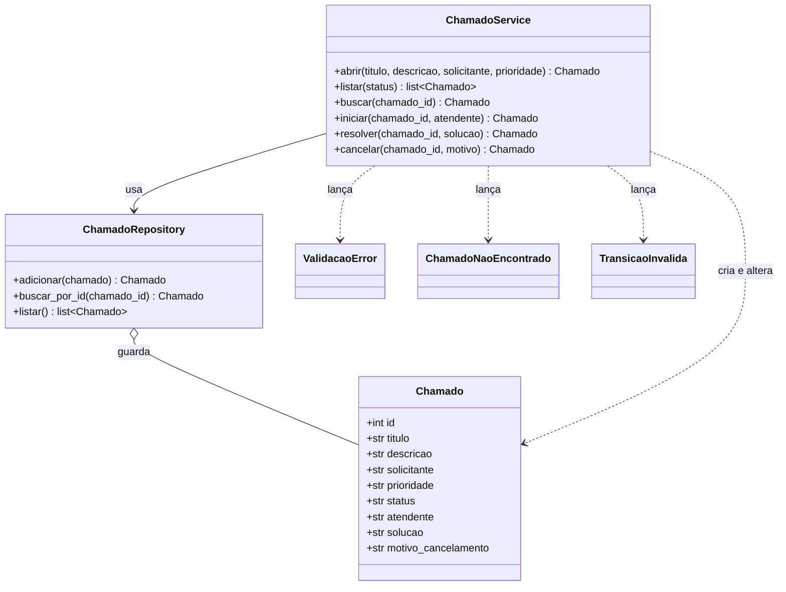

# Modelagem – HelpDesk Mini

## Diagrama de classes

## Tabela de transições

| Status atual | Operação | Status novo | Exige |
| --- | --- | --- | --- |
| `aberto` | iniciar | `em_andamento` | atendente válido |
| `em_andamento` | resolver | `resolvido` | solução válida |
| `aberto` | cancelar | `cancelado` | motivo válido |
| `em_andamento` | cancelar | `cancelado` | motivo válido |

Qualquer outra combinação gera `TransicaoInvalida`.

## Papel de cada classe

- **Chamado:** entidade que carrega os dados de um pedido de apoio.
- **ChamadoRepository:** guarda e recupera chamados em memória, sem regras de negócio.
- **ChamadoService:** valida campos, controla ids e aplica as transições de status.
- **ValidacaoError:** sinaliza campo fora da regra.
- **ChamadoNaoEncontrado:** sinaliza id inexistente.
- **TransicaoInvalida:** sinaliza mudança de status fora da tabela.
